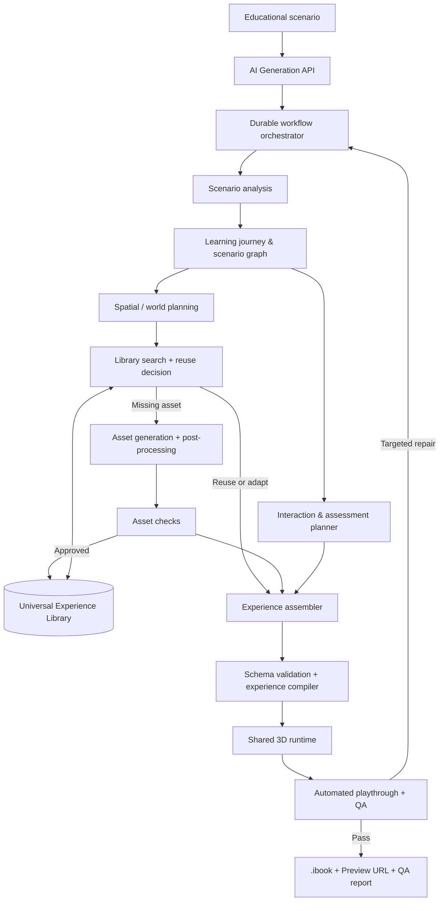

# INTERACTIVE BOOKS

## AI Agent - Engineering Execution Plan

**Version:** 1.0 (Proposed)

**Date:** 20 November 2026

**Audience:** AI, Backend, 3D/Frontend, DevOps and QA teams

**Status:** Planning baseline - implementation decisions subject to demo review and technical benchmarks

---

## 1. Mission and expected result

Build an **AI-powered Experience Generation Engine** that accepts an educational scenario and produces a **complete, playable, interactive 3D learning experience** with minimal manual assembly.

The generator must **search, reuse and adapt** items from a continuously expanding **Universal Experience Library** before generating missing items. The output is a versioned **.ibook experience package**, a playable web preview, and a validation report.

**Design principle:** The AI creates the experience specification and missing components; a shared, testable **3D Runtime** executes the experience. We do **not** generate a separate bespoke web application for every scenario.

**First demonstration of success:** Submit a previously unseen educational scenario; automatically produce a navigable world with meaningful interactions, at least one decision branch, learning feedback, and an exportable package. Run the same pipeline on a second, meaningfully different scenario without scenario-specific application code.

### What is not part of the first milestone

- Photorealistic, entirely novel worlds for arbitrary unconstrained requests.

- Free-form, LLM-generated gameplay logic executed unsandboxed in a student's browser.

- Full multiplayer, VR, or open-ended real-world physics fidelity.

- Automatic scientific or safety certification. Domain-sensitive facts and actions require approved rules/content.

---

## 2. High-level system design



### System boundaries

| Component | Owns | Does not own |

|---|---|---|

| **AI Service** | Scenario parsing; planning; agent workflows; model/provider adapters; asset selection/generation; compilation orchestration; QA coordination; package publishing | Main product users, billing, LMS permissions or student accounts |

| **Universal Experience Library** | Catalog, provenance, licensing, metadata, semantic retrieval, asset versioning, reusable behavior recipes | Student-facing UI |

| **Shared 3D Runtime** | Rendering, cameras, navigation, collision, physics, state transitions, interaction execution, audiovisual playback | Content generation or runtime LLM reasoning per frame |

| **Core Backend / LMS** | Authentication, tenant/user ownership, projects, assignments, courses, enrollments, student records | Internal AI model routing and generation logic |

**Integration rule:** The AI Service is independently deployed behind documented APIs. The core backend uses asynchronous generation jobs, receives events, and stores its own product-domain state.

---

## 3. Contracts FIRST: the experience data model

The team must agree on **versioned, machine-validated contracts** before creating independent agents.

| Artifact | Produced by | Main content |

|---|---|---|

| scenario_spec.json | Scenario Analyst | Learning goals, entities, actors, location, required actions, facts, constraints, unknowns |

| experience_graph.json | Experience Designer | Objectives, states, decisions, conditions, success/failure paths, feedback |

| world_spec.json | World Planner | Zones, geometry, coordinates, spawns, lighting, object placements, reachability constraints |

| asset_plan.json | Retrieval Planner | Required assets, reuse/adapt/generate decision, fit criteria, provider requests |

| asset_manifest.json | Asset Pipeline | Versioned asset IDs/URIs, scale, pivots, colliders, animations, provenance, license |

| interaction_graph.json | Interaction Planner | Triggers, actions, permissions, state effects, object capabilities, feedback hooks |

| assessment_spec.json | Learning Designer | Objective mapping, evidence, scoring or qualitative feedback, completion rules |

| experience_manifest.json | Compiler | Schema/runtime versions; immutable references; dependencies; locale; package checksum |

| qa_report.json | QA Pipeline | Checks, playthrough paths, blockers, repair attempts, unresolved issues |

### Minimal example: contract structure (illustrative; NOT the final schema)

```json

{

"schema_version": "0.1.0",

"experience_id": "warehouse-training-001",

"runtime": { "mode": "first_person", "minimum_version": "0.1.0" },

"objectives": [{ "id": "o1", "title": "Identify the hazard" }],

"world": { "zones": ["warehouse"], "player_spawn": "entrance" },

"entities": [

{ "id": "fire_extinguisher_01", "asset_ref": "asset:extinguisher-co2@1.0.0",

"capabilities": ["inspect", "pick_up", "use"] }

],

"scenario": { "start_state": "observe", "graph_ref": "experience_graph.json" },

"assessment_ref": "assessment_spec.json"

}

```

**Hard rules:** IDs must be stable; assets must have versions; all external URLs are validated; no executable arbitrary scripts within an imported package; broken entity/asset references are release-blocking. The schema uses meters, consistent coordinate axes, and explicit localization IDs.

---

## 4. How the AI agent works: stage-by-stage

| Step | Agent / tool | Exact work | Input | Output | Acceptance condition |

|---|---|---|---|---|---|

| **1** | Scenario Analyst (LLM) | Parse script, extract objectives/objects/actions, mark ambiguities and source evidence | User script + policy | scenario_spec | Schema valid; required learning objectives identifiable; no silently invented critical facts |

| **2** | Experience Designer (LLM + rule validators) | Create beginning, mission steps, branch conditions, feedback and endings | Scenario spec | experience_graph, assessment_spec | Every objective maps to at least one observable action; branches have valid outcomes |

| **3** | World Planner (LLM + spatial tools) | Plan zones, scene layout, player spawn, prop placements, accessibility and navigation | Experience graph + entities | world_spec | All required zones and interactive targets are reachable |

| **4** | Library Retrieval (search + reranker) | Search reusable world pieces, props, characters, movements, sound and interaction behaviors | Required entities + constraints | Candidate matches | Candidate metadata includes functionality, performance and license |

| **5** | Asset Decision Engine (rules + LLM) | Choose **reuse / adapt / procedural / generate**, based on semantic and technical fit | Candidates + world plan + budget | asset_plan | Explicit rationale; within generation policy and budget |

| **6** | Asset Workers (provider APIs + Blender tools) | Produce only missing content; normalize scale, topology, textures, colliders, LOD where relevant | Asset plan | Validated GLB/media/metadata | Technical checks and rights checks pass before promotion to library |

| **7** | Interaction Planner (LLM + component registry) | Bind actions, triggers, prerequisites and state changes to objects | Experience graph + object capabilities | interaction_graph | Every referenced action supported; no invalid transitions |

| **8** | Assembler / Compiler (deterministic) | Resolve references, assemble scenes, pack dependencies, validate all schemas | Specs + validated assets | Runtime-ready experience | Zero missing references; compatible runtime version |

| **9** | Playthrough QA (automated + visual model) | Exercise branches; check collisions, navigation, animation, render, learning outcomes and logs | Experience + runtime | qa_report | Required paths executable; blockers eliminated or explicitly escalated |

| **10** | Publisher (deterministic) | Sign/version artifact, publish preview, emit job results | QA-approved build | .ibook, URL, report | Artifact can be reloaded by clean runtime installation |

**Workflow behavior:** Each stage stores an immutable output with inputs, prompt/model/provider versions, cost and status. An incomplete job can resume from a checkpoint. Failures trigger **targeted** rework, not regeneration of the entire experience. Maximum retry counts prevent infinite loops.

---

## 5. Universal Experience Library: minimum architecture

**Not just a directory of .glb files.** The library is a searchable catalog of **usable** 3D components and patterns.

Asset families to support initially:

1. **Environment pieces:** walls, floors, doors, shelving, lighting, room modules.

2. **Props:** tools, educational objects, furniture, equipment.

3. **Actors:** rigged characters, poses and movement clips.

4. **Behaviors:** inspect, open, pick up, place, combine, activate, talk, operate.

5. **Audio/VFX:** ambience, feedback sounds, particles, UI indications.

6. **Educational patterns:** observe → decide → act → evaluate; procedural tasks; branching consequences.

Every catalog entry needs at minimum: asset_id, semantic name/tags, kind, preview image, file URI and hash, format, dimensions and units, origin/pivot, collision profile, supported interaction capabilities, dependencies, complexity/size metrics, license, source/provenance, quality status, version and created-by pipeline.

### Asset routing policy

```text

REQUIRED COMPONENT

-> exact functional match available? -> REUSE

-> acceptable near-match? -> ADAPT

-> geometry defined by dimensions? -> PROCEDURAL BUILD

-> otherwise -> GENERATE NEW

-> PROCESS -> QA -> CATALOG

```

A good visual similarity score **alone** must never authorize reuse: the correct semantic type, behavior, dimensions, technical format and permitted use matter. Generated content is quarantined until validation; only approved assets enter the shared library. Use immutable version references and license tracking.

**Suggested implementation:** PostgreSQL for catalog/metadata, pgvector or equivalent for text/vector search, object storage (S3-compatible) for bytes, and GLB as the standard interchange format. Choose embeddings and multimodal retrieval through a provider abstraction and benchmark with actual library items.

---

## 6. Shared 3D runtime: build this before advanced generation

**Web-first candidate stack:** React + Three.js / React Three Fiber, Rapier for physics, TypeScript for the interaction runtime, and GLB/glTF for models. Validate against existing team demos before locking the stack.

The runtime needs these modules:

- ExperienceLoader: schema version validation, asset resolving, dependency preload, error handling.

- SceneBuilder: procedural geometry and model placement from world_spec.

- PlayerController: first-person camera, movement, interaction reach and device input.

- ObjectRegistry: entity IDs, capabilities, interaction hotspots and collider info.

- InteractionEngine: inspect, select, open, pick up, place, use and event triggers.

- ScenarioStateMachine: valid transitions, conditional branches, checkpoints, reset.

- LearningFeedback: hints, objective indicators, consequence messages, completion.

- AudioAnimationSystem: playback and synchronized actions.

- Telemetry: action events, stage timing, errors and test hooks.

**No arbitrary LLM outputs are executed during gameplay.** Complex new behavior must become a reviewed reusable component or run in a restricted, tested sandbox and be promoted through normal release review.

### First runtime acceptance test

A developer provides **only JSON + catalog assets**: a room, player spawn, door and two interactive objects. The shared runtime loads it, allows movement, performs at least three interactions, executes a conditional branch, displays feedback and completes a session **without writing scenario-specific React code**.

---

## 7. Model and provider routing (candidates, not locked)

| Capability | Proposed model/tool class | Selection approach |

|---|---|---|

| Scenario + journey planning | Structured-output reasoning LLM | Versioned prompt; Pydantic/JSON Schema; compare factuality/graph validity/cost |

| Spatial planning | Reasoning LLM **plus deterministic geometry/constraint tools** | Reachability and collision validator has final authority |

| Semantic asset retrieval | Text embedding + optional visual embedding and reranker | Benchmark on labeled relevant/irrelevant library assets |

| Concept references | Image generation API, when necessary | Style consistency, reproducibility, asset-provider suitability |

| 3D assets | **Tripo** and **Meshy** as initial API candidates | Compare GLB validity, geometry, textures, latency, cost, editability |

| Standard geometry | Procedural generation + Blender automation | Prefer deterministic construction for walls, floors, measurements |

| Rigging + animation | Reusable rigs/clips first, provider auto-rig as needed | Correct bones, retargeting, collision and action completion |

| Voice / effects | Licensed audio library first, audio generation provider as needed | Language, clarity, timing, licensing, cacheability |

| Runtime QA | Test harness + optional vision-capable LLM | Deterministic tests gate release; visual judgment is supporting evidence |

All providers are called through typed adapters with rate limits, retries, budget caps, usage metadata, version capture and fallback behavior. Never couple experience JSON to one vendor's proprietary response format.

---

## 8. Service APIs and job lifecycle

**The core backend calls the AI service asynchronously**. Proposed contract:

| Method | Endpoint | Purpose |

|---|---|---|

| POST | /v1/generations | Start a scenario-to-experience generation job; returns job_id |

| GET | /v1/generations/{job_id} | Stage, progress, current status, costs, warnings, output refs |

| GET | /v1/generations/{job_id}/events | SSE event stream or event polling |

| POST | /v1/generations/{job_id}/cancel | Cancel safely and release provider/worker work where possible |

| POST | /v1/generations/{job_id}/retry | Retry an eligible failed/paused stage with a new attempt |

| GET | /v1/experiences/{experience_id}/manifest | Retrieve experience metadata + versions |

| GET | /v1/experiences/{experience_id}/package | Download signed/authorized .ibook |

| GET | /v1/experiences/{experience_id}/preview | Obtain preview link subject to authorization |

**Baseline requirements:** API versioning; authenticated service-to-service access; per-tenant authorization; idempotency keys; structured errors; signed webhooks or authenticated events; model budgets; audit trails. Avoid embedding private secrets inside experience packages.

**States:** queued → analyzing → designing → planning_world → resolving_assets → generating_assets → assembling → validating → published, with paused_for_review, failed and cancelled as permitted alternatives.

---

## 9. Execution phases and delivery gates

### Phase 0 - Audit and decisions (discovery)

**Build:** Review every team demo: stack, source, scene and interaction design, reusable code, limitations, performance and missing steps. Inventory existing assets and legal reuse rights. Agree on target devices and a reference vertical-slice scenario.

**Deliver:** Demo comparison matrix; architecture decision record; agreed technical scope; initial risk register.

**Exit gate:** Team agrees on shared-runtime direction and contract ownership. Do not refactor all demos before this review.

### Phase 1 - Contracts and minimal runtime (foundation)

**Build:** JSON schemas and validators; versioned manifests; one scene loader; first-person control; primitives; object registry; interaction state machine; save/reset; example manually-authored experience.

**Deliver:** Runtime demo that loads experience.json and executes two alternate outcomes.

**Exit gate:** The same runtime loads two different hand-authored experiences without scenario-specific code.

### Phase 2 - Library and asset tooling

**Build:** Asset ingestion/normalization pipeline, catalog model, object storage, preview generation, tagging, semantic search, licenses, provenance and content hashing. Seed library from approved demo assets and reusable primitives.

**Deliver:** Searchable catalog with supported interaction metadata; CLI/API for ingest and lookup.

**Exit gate:** Runtime can retrieve and place a selected catalog item by immutable ID.

### Phase 3 - Agent planning pipeline

**Build:** Durable generation workflow, Scenario Analyst, Experience Designer, World Planner, Interaction Planner. Structured model calls; contracts; retries; checkpoints; stage artifacts; validation feedback.

**Deliver:** Text scenario → valid scenario_spec, experience_graph, world_spec, interaction_graph, assessment_spec.

**Exit gate:** Plans pass schema/semantic checks and load into a **graybox playable experience** using primitives and library items.

### Phase 4 - Missing-asset generation and automatic assembly

**Build:** Reuse/adapt/procedural/generate router, Tripo/Meshy provider adapters, Blender/glTF processing, QA quarantine, asset manifest resolution, auto assembler and packaging.

**Deliver:** Novel scenario with at least one newly generated asset and working interactions; created asset becomes reusable after approval.

**Exit gate:** Same pipeline resolves both reused and generated assets without code changes to the runtime.

### Phase 5 - Automated QA, repair and publishing

**Build:** Navigation/reachability checks; reference checks; path coverage tests; browser-based playthrough; visual screenshots; targeted repair policy; signed package and preview publishing; telemetry.

**Deliver:** .ibook package, QA report, published web preview and failed-case reproduction artifacts.

**Exit gate:** Required scenario paths complete on supported test devices; no blocking schema, missing asset or impossible interaction defects.

### Phase 6 - Pilot and hardening

**Build:** Performance profiling, concurrency limits, cost accounting, tenant security, caching, access controls, version migrations, rollback, documentation and operational dashboards.

**Deliver:** Pilot-ready service with runbook, benchmarks and known limitations.

**Exit gate:** Agreed pilot acceptance criteria met on more than one educational domain and target device class.

> **Sequence:** P0 informs choices; P1 and P2 can progress in parallel after contract agreement; P3 depends on P1 schemas; P4 requires P2 + P3; P5 integrates the full slice. Do not build all specialists as independent LLM agents at the outset.

---

## 10. Team workstreams - ready to assign in the PM board

| ID | Task | Suggested owner role | Dependencies | Done when |

|---|---|---|---|---|

| IB-01 | Audit and reverse-engineer all demos | All demo developers | None | All reports submitted; comparison matrix prepared |

| IB-02 | Approve architecture, runtime and schemas | AI lead + 3D lead + BE lead | IB-01 | ADR + schema version approved |

| IB-03 | Build JSON contracts and validators | AI/Backend | IB-02 | Valid/invalid fixtures tested in CI |

| IB-04 | Build minimal shared 3D runtime | 3D/Frontend | IB-02 | Two data-driven scenarios playable |

| IB-05 | Implement interaction registry + scenario state machine | 3D/Frontend | IB-03, IB-04 | Actions, conditions and feedback tested |

| IB-06 | Create asset catalog/storage/metadata | Backend/AI | IB-02 | Create/search/version asset APIs working |

| IB-07 | Create GLB ingestion and optimization workers | 3D/AI | IB-06 | Ingested assets validated and previewed |

| IB-08 | Implement retrieval and asset decision policy | AI | IB-06 | Reuse/adapt/procedural/generate decisions logged |

| IB-09 | Implement durable workflow orchestrator | AI/Backend | IB-03 | Runs resume; cancellation and retries work |

| IB-10 | Implement scenario + experience planning | AI | IB-03, IB-09 | Valid scenario and graph artifacts produced |

| IB-11 | Implement spatial planning + reachability checks | AI/3D | IB-04, IB-10 | Graybox layout playable and traversable |

| IB-12 | Implement interaction + assessment planning | AI/3D | IB-05, IB-10 | All action bindings executable |

| IB-13 | Implement 3D generation provider adapters | AI | IB-07, IB-08 | Candidate providers benchmarked and swappable |

| IB-14 | Implement automatic scene assembly/compiler | 3D/AI | IB-08, IB-11, IB-12 | Spec + assets → preview without scenario code |

| IB-15 | Implement QA harness and targeted repair | QA/AI/3D | IB-14 | Branch, reachability, reference tests and failure reports |

| IB-16 | Implement .ibook packaging and preview publishing | Backend/DevOps | IB-14, IB-15 | Clean runtime loads published artifact |

| IB-17 | Integrate core Backend ↔ AI Service | Backend | IB-09, IB-16 | Authenticated async generation and status events |

| IB-18 | Run cross-domain pilot, benchmarks and handover | All | IB-17 | Acceptance evidence, risks and runbook delivered |

**Assignment guidance:** Every card should include task description, inputs, deliverables, dependency IDs, acceptance tests, code location and owner. Owners are roles here, not assumed named individuals.

---

## 11. Repository and implementation layout (proposed)

```text

interactive-books/

├── contracts/ # JSON Schema, Pydantic models, fixtures

├── ai-service/

│ ├── app/api/ # generation jobs, status, artifacts

│ ├── app/workflows/ # durable orchestration and checkpoints

│ ├── app/agents/ # scenario, experience, world, interactions

│ ├── app/providers/ # LLM, image, 3D, voice adapters

│ ├── app/library/ # retrieval, selection, asset policy

│ ├── app/compilation/ # assembly, manifest and packaging

│ ├── app/validation/ # semantic, spatial, scenario QA

│ └── tests/

├── runtime-web/

│ ├── src/engine/ # loader, state, physics, controllers

│ ├── src/components/ # reusable interactive components

│ ├── src/scenes/ # generic scene composition

│ └── tests/

├── asset-pipeline/ # Blender scripts, GLB checks, thumbnails

├── qa-harness/ # browser tests and scripted playthroughs

├── samples/ # test scripts and golden .ibook fixtures

├── infra/ # Docker, deployment, worker config

└── docs/ # ADRs, API contracts, benchmark results

```

A monorepo is an initial coordination convenience. The independently deployable AI Service and runtime should maintain clear package/service boundaries even if separate repositories are chosen later.

---

## 12. Definition of Done for the first complete vertical slice

A build is accepted when all of the following are evidenced:

- [ ] Input is an **unseen** scenario, not pre-wired demo content.

- [ ] Versioned scenario_spec, experience graph, world spec and interaction graph are produced and pass validators.

- [ ] System uses catalog assets and generates or procedurally constructs a missing component with recorded origin.

- [ ] Player can enter the world, move, interact and finish a learning objective.

- [ ] At least one choice leads to two distinguishable outcomes and feedback.

- [ ] Required objects are reachable; all references resolve; no terminal dead-end on intended success paths.

- [ ] Same runtime works for a **second unrelated scenario** without new scenario-specific application code.

- [ ] End-to-end logs include provider versions, duration, cost, inputs, outputs and errors, without exposing secrets.

- [ ] An approved .ibook loads into a clean runtime and an authorized preview URL works.

- [ ] QA produces a pass/fail report and a reproducible failed-case artifact when needed.

**Performance, generation cost and allowed manual review are pilot targets to agree on after measuring real end-to-end runs**, not numbers assumed in advance.

---

## 13. Main engineering risks and controls

| Risk | Control |

|---|---|

| Beautiful world but broken interactions | Make interactive capabilities and state-graph contracts first-class; mandatory playthrough tests |

| AI hallucinated educational facts | Approved content/rules, source traceability, domain review gate for sensitive topics |

| 3D asset looks good but is unusable | Mesh/pivot/unit/collider/scale/rig validation and import quarantine |

| Library becomes inconsistent or bloated | Immutable versions, provenance, deduplication by hash, asset lifecycle policy |

| Provider costs or timeouts spike | Reuse-first policy, cached generations, per-job budgets, quotas, bounded retries |

| Gameplay generation becomes unsafe code execution | Declarative behaviors; sandbox and manual review for new executable modules |

| Runtime performance collapses on mobile | Model budgets, LOD, texture compression, profiling and device tiers |

| Agents cannot recover from failure | Durable checkpoints, idempotent nodes, job cancellation and targeted repair |

| Team branches diverge | Contracts in CI, golden test scenarios, phase gates and architecture decisions |

---

## 14. Immediate kickoff sequence

**First, without waiting for every asset/model provider decision:**

1. Collect demo reverse-engineering deliverables and nominate the reference scenario.

2. Assign **IB-02/03/04/06/09** (architecture/contracts/runtime/library/orchestrator) to workstream owners.

3. Agree on the schema and implement **one hand-authored .ibook-compatible experience** end to end.

4. Add the minimal reusable action set: inspect, select, open, pick_up, use, place, trigger.

5. Integrate agent planning against the same schema, initially with graybox scenes.

6. Add library retrieval, then missing-asset generation, then automated playthrough and publishing.

**The first team review should inspect working artifacts, not slides:** (a) schema fixture; (b) runtime video/URL; (c) library sample; (d) sample agent trace; and (e) blocked dependencies.

---

## 15. Decisions to confirm before implementation expands

- Browser and device targets, including mobile minimum tier.

- Target educational domains and first two reference scenarios.

- Allowed visual styles (stylized vs realistic) and safety/accuracy review policy.

- Asset licensing and whether external/generated assets may be cataloged centrally.

- Budget ceilings and provider credentials, deployment/GPU limits and data residency policies.

- Human approval points: early pilot vs fully automatic publication.

- Whether the .ibook portable export must operate offline; the initial thin package may instead reference centrally hosted assets.

These decisions should not block building the **contracts and minimal shared runtime**; they do govern provider selection, pilot acceptance and production deployment.

---

## Reference documentation (technology candidates)

- LangGraph persistence / interrupts: https://docs.langchain.com/oss/python/langgraph/overview and https://langchain-ai.github.io/langgraph/how-tos/human_in_the_loop/breakpoints/

- React Three Fiber: https://r3f.docs.pmnd.rs/getting-started/introduction

- Tripo API: https://developers.tripo3d.com/en

- Meshy API: https://docs.meshy.ai/en/api/quick-start

- glTF Transform: https://gltf-transform.dev/

- Blender command-line: https://docs.blender.org/manual/en/4.2/advanced/command_line/arguments.html

**Document owner:** Interactive Books Engineering Team

**Next review:** At completion of Phase 0 and before schema/runtime architecture approval.